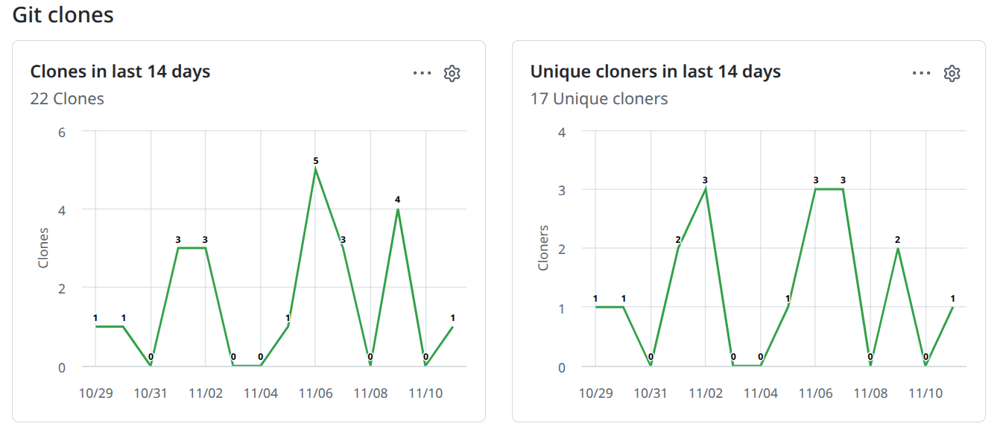

```python
print("Code blocks work out of the box!")
```

I didn't think this would take me five years to do, but the truth is I have been more invested in making YAKKO shine than telling the world. So here it is, a place to read about YAKKO and all its internals.

How did I get here? Put simply, since OpenShift 5 started coming alive I began putting some effort into supporting it. Under the hood, OpenShift 5 is not a revolution from the installation front, but after so many years of expecting a "4.x" prefix, the code wasn't ready. But it now is! And the community intent is clear - tracking the cloning of YAKKO proves that after 10 months of no change, people having been cloning it more than once a day. Not bad for software that is 9 months old right? 



And so it is that with the launch of OpenShift 5 it only made sense to double down my efforts and release a nice round number version for YAKKO, why not score it with a 10? And this 10 comes loaded, visit the project page to check what's new, and prepare because this release will also bring GPU mapping. It's the AI era after all.
